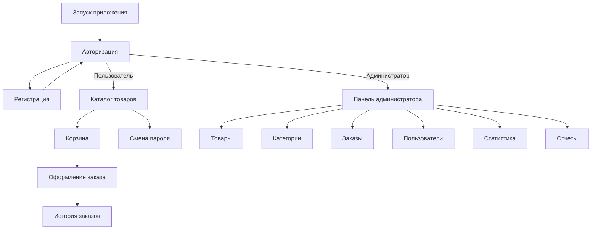
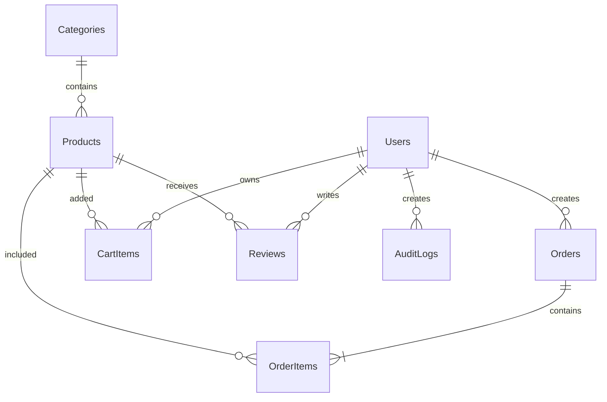

# ElektronikaShop


## О проекте

**ElektronikaShop** — курсовой проект на WPF C# по теме:

> Интернет-магазин электроники

Приложение разработано по методическим указаниям УП.01.01.

Проект использует:

- WPF;
- C#;
- .NET Framework;
- Microsoft SQL Server;
- Entity Framework Database First;
- LINQ;
- PBKDF2 для хэширования паролей;
- ClosedXML для экспорта в Excel;
- DocumentFormat.OpenXml для экспорта в Word;
- Git и GitHub.

## Возможности приложения

### Пользователь

- регистрация;
- авторизация;
- проверка введенных данных;
- хэширование пароля;
- капча после трех неправильных попыток входа;
- просмотр каталога товаров;
- поиск товаров;
- фильтрация по категориям;
- сортировка товаров;
- добавление товаров в корзину;
- удаление товаров из корзины;
- оформление заказа;
- просмотр истории заказов;
- смена пароля;
- переключение светлой и темной темы.

### Администратор

- просмотр товаров;
- добавление товаров;
- удаление товаров;
- управление категориями;
- просмотр заказов;
- изменение статуса заказа;
- просмотр пользователей;
- поиск пользователей;
- блокировка и разблокировка пользователей;
- просмотр статистики;
- просмотр выручки;
- экспорт отчетов в Word и Excel.

## Навигация приложения



## База данных

База данных называется:

```text
DB_ElektronikaShop
```

Скрипт создания базы данных находится в файле:

```text
db
```

В базе данных используются следующие таблицы:

| Таблица | Назначение |
|---|---|
| `Users` | Пользователи, роли и пароли |
| `Categories` | Категории товаров |
| `Products` | Товары магазина |
| `Orders` | Заказы пользователей |
| `OrderItems` | Состав заказов |
| `CartItems` | Корзина пользователя |
| `Reviews` | Отзывы о товарах |
| `AuditLogs` | Журнал действий |

## Схема базы данных



В базе данных настроены:

- первичные ключи;
- внешние ключи;
- уникальные ограничения;
- проверки значений;
- каскадное удаление зависимых записей;
- тестовые данные.

## Подключение базы данных

Для подключения используется Entity Framework Database First.

В Visual Studio необходимо выбрать:

```text
Add
→ New Item
→ ADO.NET Entity Data Model
→ EF Designer from database
```

После подключения базы данных создается контекст:

```csharp
DB_ElektronikaShopEntities
```

Общий доступ к базе осуществляется через класс `Core`:

```csharp
public static class Core
{
    public static DB_ElektronikaShopEntities Context =
        new DB_ElektronikaShopEntities();
}
```

Пример получения товаров:

```csharp
var products = Core.Context.Products
    .Where(x => x.IsActive == true)
    .OrderBy(x => x.Name)
    .ToList();
```

Пример сохранения изменений:

```csharp
Core.Context.SaveChanges();
```

## Структура проекта

```text
ElektronikaShop/
│
├── db/
│   └── EliktronikaShop.sql
│
├── Data/
│   └── Core.cs
│
├── Pages/
│   ├── AuthPage.xaml
│   ├── RegisterPage.xaml
│   ├── CatalogPage.xaml
│   ├── CartPage.xaml
│   ├── CheckoutPage.xaml
│   ├── OrdersPage.xaml
│   ├── ChangePasswordPage.xaml
│   ├── AdminDashboardPage.xaml
│   ├── ProductManagementPage.xaml
│   ├── CategoryManagementPage.xaml
│   ├── OrderManagementPage.xaml
│   ├── UserManagementPage.xaml
│   ├── StatisticsPage.xaml
│   └── ReportsPage.xaml
│
├── Services/
│   ├── PasswordHasher.cs
│   └── CaptchaService.cs
│
├── Resources/
│   ├── Dictionary.xaml
│   ├── LightTheme.xaml
│   └── DarkTheme.xaml
│
├── App.xaml
├── App.config
├── MainWindow.xaml
├── MainWindow.xaml.cs
├── ElektronikaShop.csproj
└── README.md
```

## Словарь стилей

В проекте используются следующие цвета:

| Назначение | Цвет |
|---|---|
| Основной бирюзовый | `#0198AF` |
| Темно-синий | `#323B78` |
| Фон светлой темы | `#FFFFFF` |
| Поверхность светлой темы | `#F5F7FA` |
| Фон темной темы | `#20242D` |
| Поверхность темной темы | `#2A303B` |
| Основной светлый текст | `#F4F7FB` |
| Цвет ошибки | `#E34242` |
| Шрифт | Open Sans |

Стили хранятся в файлах:

```text
Resources/Dictionary.xaml
Resources/LightTheme.xaml
Resources/DarkTheme.xaml
```

Смена цветов выполняется через:

```xml
DynamicResource
```

## Тестовые пользователи

| Логин | Пароль | Роль |
|---|---|---|
| `admin` | `Admin123!` | Администратор |
| `ivanov` | `User123!` | Пользователь |

## Запуск проекта

1. Установить Visual Studio 2022.
2. Установить workload **.NET desktop development**.
3. Установить Microsoft SQL Server.
4. Открыть SQL Server Management Studio.
5. Выполнить файл:

```text
db/
```

6. Подключить Entity Framework Database First.
7. Проверить строку подключения в `App.config`.
8. Открыть проект в Visual Studio.
9. Нажать клавишу:

```text
F5
```

## Проверка требований задания

| Требование | Состояние |
|---|---|
| База данных и связи | Выполнено |
| 6–8 таблиц | Выполнено |
| Подключение WPF к БД | Выполнено |
| Авторизация | Выполнено |
| Регистрация | Выполнено |
| Разграничение ролей | Выполнено |
| Хэширование паролей | Выполнено |
| Капча | Выполнено |
| Каталог пользователя | Выполнено |
| Поиск, сортировка и фильтрация | Выполнено |
| Корзина и заказы | Выполнено |
| Смена пароля | Выполнено |
| Административная панель | Выполнено |
| Управление товарами | Выполнено частично |
| Управление категориями | Выполнено |
| Управление заказами | Выполнено |
| Управление пользователями | Выполнено |
| Статистика | Выполнено |
| Экспорт Word | Выполнено |
| Экспорт Excel | Выполнено |
| Экспорт PDF | Не используется |
| Светлая и темная темы | Выполнено частично |
| Подтверждение удаления и выхода | Выполнено |
| GitHub | Требует загрузки проекта |
| Отчет по практике | Требует оформления |

Имя пользователя преподавателя:

```text
TGAksenova
```

## Статус проекта

Проект находится в стадии подготовки к защите. Основные функции базы данных и WPF-приложения реализованы.
